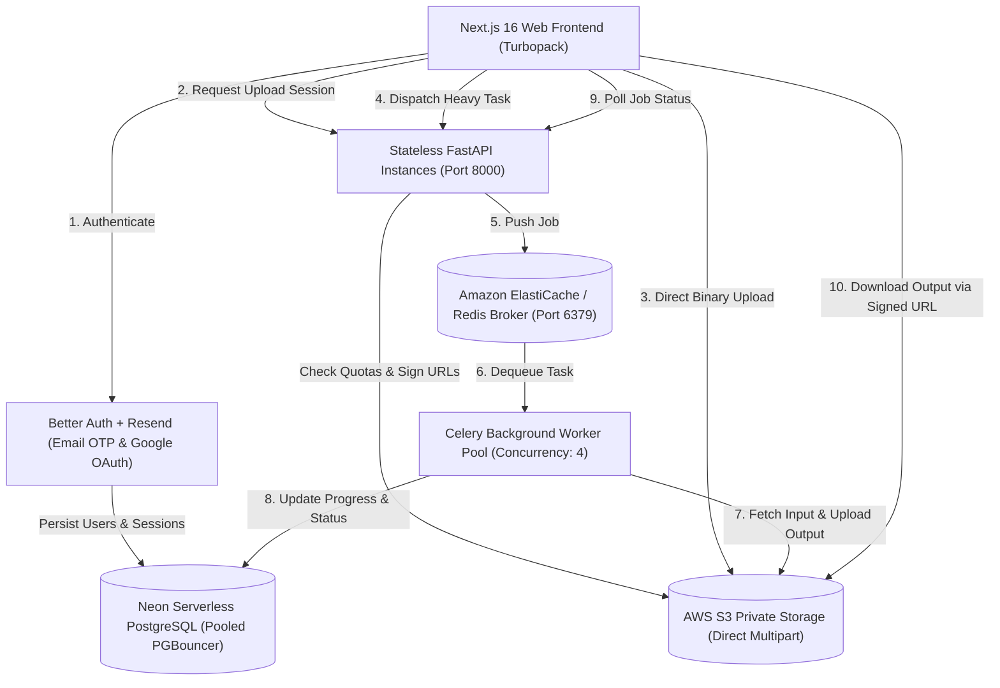

# PixelKit SaaS Platform – Architectural Blueprint & Deployment Guide

## 1. Executive Summary

PixelKit is transformed into an **Enterprise-Ready, Scalable SaaS Platform** featuring dual processing engines:
1. **100% In-Browser Private Mode (Zero Server Uploads)**: Preserves client-side confidentiality for sensitive files.
2. **Cloud SaaS Engine (AWS S3 + Neon PostgreSQL + Celery + Redis)**: Multi-tenant, asynchronous, distributed architecture designed for concurrent uploads, large document processing, OCR, and team persistence.

---

## 2. Distributed Architecture

---

## 3. Technology Stack & Component Responsibilities

| Layer | Technology | Key Configuration & Role |
| :--- | :--- | :--- |
| **Frontend** | Next.js 16.4.3, React 19, Tailwind CSS v4, Lucide | Turbopack App Router, Dashboard, File Manager, PDF Editor |
| **Authentication** | Better Auth, Google OAuth, Email OTP | Resend transactional email API, 6-digit code with cooldown timer |
| **Database** | Neon Serverless PostgreSQL | Pooled connection string (`?pgbouncer=true`), normalized schema |
| **File Storage** | AWS S3 (Private Buckets) | SigV4 presigned URLs (15 min expiry), browser multipart chunking |
| **Backend API** | Python FastAPI, Pydantic v2, Asyncpg | Stateless, request ID tracking, quota accounting, health checks |
| **Broker & Queue** | Redis 7 + Celery 5.3 | Separate queues (`pdf_queue`, `image_queue`, `ocr_queue`), auto-retry |
| **Workers** | Python Celery Workers | Isolated document conversion, Tesseract OCR, memory bounds |

---

## 4. Multi-Tenant Database Schema

The database migration is located in `database/migrations/001_initial_schema.sql` and includes:
- `user`, `session`, `account`, `verification`: Better Auth core session & identity management.
- `folders`: Hierarchical folder structure per user (`parent_folder_id`).
- `files`: File metadata (original name, stored name, mime type, file size, S3 object key, status).
- `processing_jobs`: Background Celery job status tracker (`queued`, `processing`, `completed`, `failed`), progress percentage, and error messages.
- `processing_history`: Audit trail for completed document operations.
- `storage_usage`: Atomic quota tracker preventing concurrent upload overruns.
- `subscriptions`: Free (500 MB), Pro (25 GB), and Business (100 GB) tier enforcement.

---

## 5. Security & Isolation

1. **Zero Raw Credentials in Client Code**: All S3 access keys, Redis URLs, and database connection strings are strictly kept server-side.
2. **Short-Lived Signed URLs**: All downloads and uploads use Amazon S3 presigned URLs valid for 15 minutes.
3. **Multi-Tenant Ownership Verification**: Every file download and deletion request strictly verifies `file.user_id == current_user.user_id`. User A cannot access User B's files.
4. **Direct Browser-to-S3 Multipart Upload**: Files larger than 25 MB are uploaded directly from the browser to Amazon S3 in 5 MB chunks, completely avoiding API memory bottlenecks.
